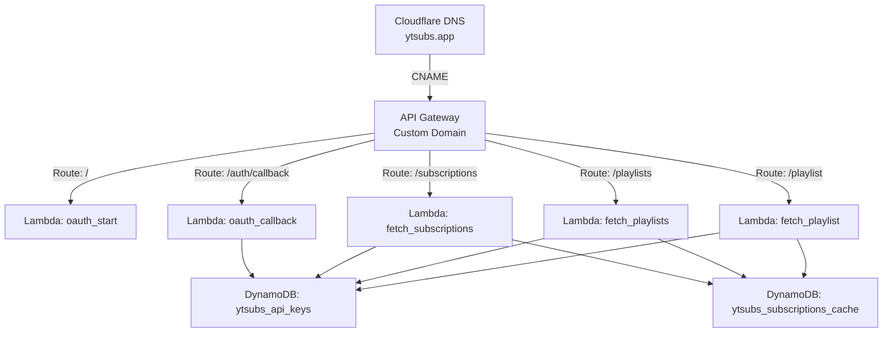

<p align="center">
  
</p>

# YTSubs: YouTube Subscriptions Exporter API Service

YTSubs is a serverless web service that allows users to authenticate with their Google account and securely retrieve a cached list of their YouTube subscriptions. This system is powered by AWS Lambda, API Gateway, DynamoDB, and GitHub Actions for continuous deployment.

This was mostly built with ChatGPT, so please provide feedback where things could be improved.

## Live URL

[https://ytsubs.app](https://ytsubs.app)


## Features

- Google OAuth2 login with YouTube access (`read-only`)
- Serverless infrastructure using AWS Lambda & API Gateway
- Automatic caching of YouTube subscriptions (refreshed every 12 hours)
- User-specific API key authentication (stored in DynamoDB)
- Friendly landing and callback pages
- GitHub Actions CI/CD for Lambda deployment

## AWS Diagram



## Repo Structure

```
ytsubs-lambdas/
├── fetch_subscriptions.py     # Lambda for /subscriptions
├── fetch_playlists.py         # Lambda for /playlists
├── fetch_playlist.py          # Lambda for /playlist
├── oauth_start.py             # Lambda for / (homepage)
├── oauth_callback.py          # Lambda for /auth/callback
├── static/                     # Static sources such as images & privacy policy
└── .github/
   └── workflows/
      └── deploy.yml         # GitHub Actions CI/CD workflow
````


## API Usage

### Get Subscriptions

```bash
curl "https://ytsubs.app/subscriptions?api_key=YOUR_API_KEY"
````

Returns:

```json
{
  "lastRetrievalDate": "2025-06-06T21:04:00Z",
  "subscriptions": [ ... ]
}
```

### Get Playlists

```bash
curl "https://ytsubs.app/playlists?api_key=YOUR_API_KEY"
````

Returns the user's own playlists plus their "Liked videos" playlist:

```json
{
  "lastRetrievalDate": "2025-06-06T21:04:00Z",
  "playlists": [
    { "id": "LL...", "kind": "liked", "title": "Liked videos" },
    { "id": "PL...", "kind": "mine", "title": "My Cool Playlist", "itemCount": 12 }
  ]
}
```

> **Note:** "Watch Later" and "History" are not included. Google removed API access to both — this isn't a scope/permission issue, the [YouTube Data API itself no longer supports it](https://developers.google.com/youtube/v3/revision_history) (see the August 11, 2016 and September 9, 2020 entries). See [docs.html](static/docs.html) for details.

### Get Playlist Items

```bash
curl "https://ytsubs.app/playlist?api_key=YOUR_API_KEY&id=PL..."
````

Returns that playlist's items, sorted by **newest added first** (when each video was added to the playlist, not its original upload date):

```json
{
  "lastRetrievalDate": "2025-06-06T21:04:00Z",
  "playlistId": "PL...",
  "items": [ ... ]
}
```

## Possible future improvements

* CloudFront for caching and rate limiting
* Per-user usage metrics
* Multi-region redundancy
